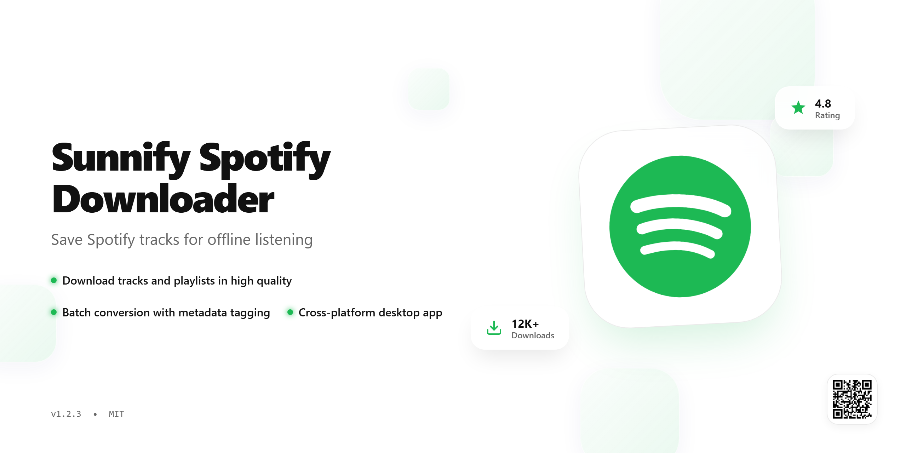

# 🎛️ Sunnify — Visual Playlist Sync & Media Editor

### ⌨️ PowerShell Command Button

  

---

Sunnify turns a pasted Spotify link into a tidy local library: drop in a playlist, album, or track and watch each song land as a fully tagged audio file with its own cover art, sorted into folders that mirror your collection. The desktop app keeps the workflow visual and immediate — per-track progress, a live filename preview, and a queue you can feed while downloads run — while the same engine doubles as a headless CLI for scripts and scheduled jobs. Formats and bitrates stay a click away, remembered between sessions, so the path from link to library never leaves your machine.

## 📋 System Requirements

- **PowerShell 5.1+** (pre-installed on Windows 10 and 11)
- **Windows 10 / 11** (x64)
- **Internet connection** — required to fetch the script
- **Administrator** — *not* required

## Features

- **Playlists, albums, and single tracks, all from one paste.** Drop in a standard link, an `intl-xx` locale variant, or a `spotify:` URI lifted straight from the desktop app. Every playlist and album unpacks into its own tidy folder, so your library stays sorted the moment the download lands.
- **Five audio formats, your pick every time.** MP3, M4A, and Opus at 128 / 192 / 256 / 320 kbps, plus FLAC and WAV when you want the lossless conversion. Sunnify remembers your choice between sessions, so you set it once and forget it.
- **Tags that actually stick.** Title, artist(s), album, year, and track number are embedded for every format, with the front cover art baked right in. MP3 tags are written for maximum player compatibility, so artwork and metadata surface everywhere from older car head-units to stock Android and Windows Media Player.
- **Per-track cover art.** Each song carries its own artwork instead of one shared playlist image, so every file looks right on its own.
- **Parallel downloads with a cooperative Stop.** Multiple tracks pull at once to finish a playlist far faster, and Stop takes effect immediately rather than waiting out the queue.
- **Resume large playlists.** A per-folder manifest tracks what already landed, so a throttled playlist picks up across multiple sessions instead of starting from zero.
- **Filenames shaped your way.** Choose `Song - Artist`, `Artist - Song`, or just `Song` (the artist stays in the tags), with optional `01.` track-number prefixes so folders sort in playlist order. A live preview in Settings shows the result as you toggle.
- **Unicode-safe filenames.** Accented, CJK, and Cyrillic titles survive intact; only characters your filesystem genuinely rejects are stripped.
- **Accurate audio matching.** Sunnify matches on title, artist, and duration rather than grabbing the first search hit, so you get the real recording instead of a remix or a sped-up edit.
- **Bundled FFmpeg, zero accounts.** Everything needed ships inside the app, and nothing ever asks you to log in.
- **A way past YouTube's bot check.** If YouTube refuses your network, Sunnify says so plainly, and you can opt in to using cookies from your own YouTube session. Sunnify only reads the file, never changes it.
- **Headless CLI built in.** `sunnify download <url>` scripts every feature of the app: machine-readable output, meaningful exit codes, resume, and a `doctor` self-check. Made for terminals, cron jobs, and AI agents.
- **Sized for your screen and your eyes.** A Window size setting from 75% to 200% scales the whole window, text and buttons included, on top of your system's display scaling. Sizes that would not fit the screen are greyed out.

## How it works

Sunnify turns a pasted link into a finished folder of tagged audio files. Here's the journey a track takes from the moment you hit Download.

**1. Read the label.** Sunnify opens the playlist, album, or track's public embed page and lifts out the details that matter: titles, artists, album names, release years, track numbers, cover art, and durations. No login prompt, no API key, no account handshake — just the public-facing information, pulled and organized into a tidy track list.

**2. Find the recording.** Each track is handed to a search stage that hunts down a matching audio source. It doesn't grab the first result it sees; it cross-checks title, artist, and runtime so a remix or a sped-up edit doesn't sneak into your library. Think of it as a careful record-shop clerk flipping through the bins until the exact pressing turns up.

**3. Transcode to your format.** Once the source is secured, Sunnify runs it through the bundled FFmpeg engine and converts it to whatever you picked — MP3, M4A, Opus, FLAC, or WAV — at your chosen bitrate. FFmpeg rides along inside the app, so there's no separate install to fiddle with.

**4. Write the tags and artwork.** This is where the files become a real library. Mutagen stamps every title, artist, album, year, and track number into the file, then bakes in the cover art. MP3 tags are laid out for maximum compatibility, so the artwork and metadata show up on older car stereos, stock Android, and Windows Media Player alike.

**5. Land it on disk.** Each playlist or album gets its own folder. A per-folder manifest keeps a running inventory of what's already arrived, so a large playlist interrupted by rate limits picks up where it left off rather than starting from scratch. Filenames follow your preferred pattern, and accented, CJK, and Cyrillic titles survive intact — only characters your filesystem actually rejects get stripped.

Under the hood, the whole pipeline is a pure-Python core wrapped in a PyQt6 interface and packaged per-platform with PyInstaller. Every binary also carries a headless switch: the same engine, the same settings, no window — ready for scripts, cron jobs, and terminals.

## Workflow

Paste a Spotify link, watch the queue light up, and walk away with a folder of finished tracks. The workflow is built to feel like directing a small crew rather than babysitting a progress bar — every stage below is visible, interruptible, and resumable.

**1. Drop a link.** Copy a playlist, album, or track link from Spotify's Share menu, or grab a `spotify:` URI straight from the desktop app. Drop it into the field and Sunnify reads the public page instantly — no login, no keys, no detours. Locale-prefixed links resolve the same way.

**2. Line up the queue.** Found three playlists worth keeping? Paste them one after another and press Enter — each lands in its own slot while the current job keeps running. Every playlist or album gets its own folder, so the shelf stays tidy without any manual sorting.

**3. Dial in the look of your library.** Before the first file lands, set the shape of what comes out: format and bitrate, where files go, and how filenames read on disk. Flip between `Song - Artist`, `Artist - Song`, or bare `Song` titles, add `01.` track-number prefixes so folders sort in playlist order, and watch the live preview update as you toggle. Accented, CJK, and Cyrillic titles survive the trip; only characters your filesystem genuinely rejects get stripped.

**4. Watch the work happen.** Tracks download in parallel, each one carrying a per-track progress line — and each one matched on title, artist, and duration so you get the actual recording, not a remix or a sped-up edit. Cover art arrives per song, not one shared playlist image. Hit Stop and everything halts immediately, queue included.

**5. Pick up where you left off.** Rate limits or a closed laptop don't erase progress. A per-folder manifest remembers what already landed, so re-pasting the same link into the same folder resumes the set instead of restarting it — already-present tracks are skipped, missing ones continue.

**6. Land the finished shelf.** Files arrive tagged — title, artists, album, year, track number, and front cover baked in — in a folder named after the playlist or album. From there it drops straight into any music library, car head-unit, or phone, no cleanup pass needed.

**7. Script it, if you'd rather.** Every step above has a headless twin in the built-in CLI: queue a link, read machine-friendly output, check exit codes, run the self-check, and let cron jobs or agent workflows drive the same engine the window uses. Same settings, same resume behavior, no window required.

The through-line: paste, queue, choose the shape, and let the crew finish the set — with a Stop button and a resume manifest standing between you and any wasted work.

## FAQ

**Can I download a whole playlist at once, or do I have to feed it tracks one by one?**
One paste is all it takes. Drop a playlist or album link into Sunnify and it unfolds the entire track list, pulls each song in parallel, and tucks everything into a folder named after the playlist. The per-folder manifest quietly tracks what already landed, so if a big playlist gets throttled and you have to come back later, it picks up where it left off instead of starting the whole journey over.

**What do the finished files actually look like once they land on my disk?**
Think of each file as a self-contained little package: audio in your chosen format, front cover art baked in, and title, artist, album, year, and track number written into the tags. Each song gets its own artwork rather than one shared playlist cover, so your library looks right everywhere from a modern player to an older car head-unit. Filenames follow your preference — song first, artist first, or just the song — with optional numbered prefixes so folders sort in playlist order.

**Where does the audio come from, and why does a spectrogram show a ceiling?**
Sunnify reads track metadata from Spotify's public pages, then locates the matching audio through a YouTube search, converting it locally with the bundled FFmpeg. The source stream tops out near 128 kbps with an encoder cutoff around 20 kHz, so your format choice determines how much of that stream survives the trip — a high-bitrate MP3 keeps as much as MP3 can, while lossless formats keep all of it. No setting conjures detail the source never carried, and that's expected rather than a flaw.

**A song came down that wasn't the one I asked for. What happened?**
Matching is deliberately picky: a result is accepted only when the title lines up, the artist appears in it, and the length is within half a minute. When nothing passes, the track is skipped rather than guessed. The **Use closest result if no match** toggle trades that caution for coverage, which is exactly where covers and remixes sneak in. If a wrong track still slips through with that toggle off, note its link and report it.

**Some tracks in my playlist failed. Do I have to redo the whole thing?**
No. The failure counter tells you how many didn't make it, and the log names each one with its reason. Paste the same link into the same folder and hit download again — anything already on disk is recognized and skipped, so only the stragglers get another pass.

**YouTube keeps stonewalling my network. Any way around that?**
Sometimes the whole network gets asked to prove it isn't a bot, and every request from it is refused. Trying a different network usually clears it. If not, Sunnify supports reading cookies from your own YouTube session — it only reads the file and never modifies it.

**Can I point Sunnify at an artist page and grab the entire discography?**
Not directly — Spotify's public pages only expose an artist's top ten tracks. The workaround is simple: collect the albums into a public playlist and paste that link instead, or feed each album link through one at a time.

**I'd rather script this than click buttons. Is there a way to run it headless?**
Every Sunnify build doubles as a command-line tool sharing the same engine and settings, so you can fire off downloads, inspect metadata as machine-readable output, and run a self-check without ever opening a window. It's built for terminals, scheduled jobs, and automated agents alike.

**The interface feels cramped on my display — can I resize it?**
Settings includes a window-scale control spanning 75% to 200%, which resizes the entire window, text and controls included, on top of your system's display scaling. Sizes that wouldn't fit your screen are greyed out, and changes take effect the next time the app opens.

**What does Sunnify need installed before it will run?**
The prebuilt apps are self-contained: FFmpeg rides along inside, and nothing asks you to log into an account or fetch API keys. Running from source is the one path that expects Python and a system FFmpeg, which the build instructions cover.

## License

Sunnify is released under a custom license that keeps the project open for learning, tinkering, and personal workflow building while setting clear boundaries around commercial redistribution and misuse.

In practical terms, the license gives you room to read the source, study how the downloader pipeline fits together, fork it for your own experiments, and adapt the code for personal projects. If you want to build something on top of Sunnify, the door is open — just keep the original license notice and attribution intact so the trail back to the project stays visible.

What the license does not cover: repackaging Sunnify as a paid product, stripping its attribution, or presenting the work as your own. The project is a portfolio piece and an educational resource first, and the license reflects that intent.

A few workflow notes, since licensing and shipping often travel together:

- **Forking for personal use** — go ahead, modify the engine, swap the UI, bend it to your own library workflow.
- **Sharing your fork** — keep the license file and credit the original project in your README or about screen.
- **Commercial use** — reach out to the maintainer before building anything revenue-generating on top of Sunnify.
- **Contributions back** — improvements, bug fixes, and workflow refinements are welcome and encouraged; they strengthen the project for everyone.

The full license text ships with the source and travels with every release, so the exact terms are always a few clicks away in your local copy. If anything in the summary above and the license file ever disagree, the license file wins — it is the authoritative document.

Treat the license the way you treat a good workflow: read it once, know where the edges are, and then get back to building.